# Healthcare System - DocTypes Relationship Flowchart

This document shows the relationships between different DocTypes in the Healthcare system.

## Main Flowchart

```mermaid
graph TB
    %% Core Entities
    Patient[Patient<br/>المريض]
    Practitioner[Healthcare Practitioner<br/>مقدم الرعاية الصحية]
    ServiceUnit[Healthcare Service Unit<br/>وحدة خدمة الرعاية الصحية]
    AppointmentType[Appointment Type<br/>نوع الموعد]
    
    %% Primary Documents
    Appointment[Patient Appointment<br/>موعد المريض]
    Encounter[Patient Encounter<br/>زيارة المريض]
    InpatientRecord[Inpatient Record<br/>سجل المريض الداخلي]
    
    %% Prescriptions (Child Tables)
    DrugPrescription[Drug Prescription<br/>وصفة الأدوية]
    LabPrescription[Lab Test Prescription<br/>وصفة الفحص المخبري]
    ProcedurePrescription[Procedure Prescription<br/>وصفة الإجراء]
    
    %% Clinical Documents
    LabTest[Lab Test<br/>الفحص المخبري]
    ClinicalProcedure[Clinical Procedure<br/>الإجراء السريري]
    VitalSigns[Vital Signs<br/>العلامات الحيوية]
    Specimen[Specimen<br/>العينة]
    SampleCollection[Sample Collection<br/>جمع العينة]
    
    %% Therapy & Rehabilitation
    TherapyPlan[Therapy Plan<br/>خطة العلاج]
    TherapySession[Therapy Session<br/>جلسة العلاج]
    PatientAssessment[Patient Assessment<br/>تقييم المريض]
    
    %% Inpatient
    InpatientMedOrder[Inpatient Medication Order<br/>طلب أدوية المريض الداخلي]
    InpatientMedEntry[Inpatient Medication Entry<br/>إدخال دواء المريض الداخلي]
    
    %% Supporting Documents
    Diagnosis[Diagnosis<br/>التشخيص]
    ServiceRequest[Service Request<br/>طلب الخدمة]
    FeeValidity[Fee Validity<br/>صلاحية الرسوم]
    PatientMedicalRecord[Patient Medical Record<br/>السجل الطبي للمريض]
    
    %% Relationships - Patient Core
    Patient -->|creates| Appointment
    Patient -->|has| Encounter
    Patient -->|has| InpatientRecord
    Patient -->|has| TherapyPlan
    Patient -->|has| VitalSigns
    Patient -->|has| PatientMedicalRecord
    Patient -->|linked to| ServiceRequest
    
    %% Appointment Relationships
    Appointment -->|links to| Practitioner
    Appointment -->|uses| AppointmentType
    Appointment -->|uses| ServiceUnit
    Appointment -->|can create| Encounter
    Appointment -->|can create| TherapySession
    Appointment -->|linked to| VitalSigns
    Appointment -->|linked to| FeeValidity
    
    %% Encounter Relationships
    Encounter -->|links to| Patient
    Encounter -->|links to| Practitioner
    Encounter -->|links to| Appointment
    Encounter -->|contains| DrugPrescription
    Encounter -->|contains| LabPrescription
    Encounter -->|contains| ProcedurePrescription
    Encounter -->|has| Diagnosis
    Encounter -->|linked to| VitalSigns
    
    %% Prescription to Document Flow
    DrugPrescription -->|creates| MedicationRequest
    LabPrescription -->|creates| LabTest
    ProcedurePrescription -->|creates| ClinicalProcedure
    
    %% Lab Test Flow
    LabTest -->|requires| Specimen
    LabTest -->|linked to| SampleCollection
    LabTest -->|uses| LabTestTemplate
    
    %% Clinical Procedure Flow
    ClinicalProcedure -->|uses| ClinicalProcedureTemplate
    ClinicalProcedure -->|linked to| ServiceRequest
    
    %% Therapy Flow
    TherapyPlan -->|uses| TherapyPlanTemplate
    TherapyPlan -->|creates| TherapySession
    TherapySession -->|links to| Appointment
    TherapySession -->|uses| TherapyType
    
    %% Inpatient Flow
    InpatientRecord -->|creates| InpatientMedOrder
    InpatientMedOrder -->|creates| InpatientMedEntry
    InpatientRecord -->|linked to| Patient
    
    %% Supporting Relationships
    ServiceRequest -->|links to| Patient
    ServiceRequest -->|links to| Practitioner
    Diagnosis -->|part of| Encounter
    FeeValidity -->|linked to| Patient
    FeeValidity -->|linked to| Appointment
    
    %% Styling
    classDef coreEntity fill:#e1f5ff,stroke:#01579b,stroke-width:3px
    classDef primaryDoc fill:#fff3e0,stroke:#e65100,stroke-width:2px
    classDef clinicalDoc fill:#f3e5f5,stroke:#4a148c,stroke-width:2px
    classDef prescription fill:#e8f5e9,stroke:#1b5e20,stroke-width:2px
    classDef therapy fill:#fff9c4,stroke:#f57f17,stroke-width:2px
    classDef inpatient fill:#fce4ec,stroke:#880e4f,stroke-width:2px
    
    class Patient,Practitioner,ServiceUnit,AppointmentType coreEntity
    class Appointment,Encounter,InpatientRecord primaryDoc
    class LabTest,ClinicalProcedure,VitalSigns,Specimen,SampleCollection,Diagnosis clinicalDoc
    class DrugPrescription,LabPrescription,ProcedurePrescription prescription
    class TherapyPlan,TherapySession,PatientAssessment therapy
    class InpatientMedOrder,InpatientMedEntry inpatient
```

## Detailed Module Breakdown

### 1. Patient Management Module

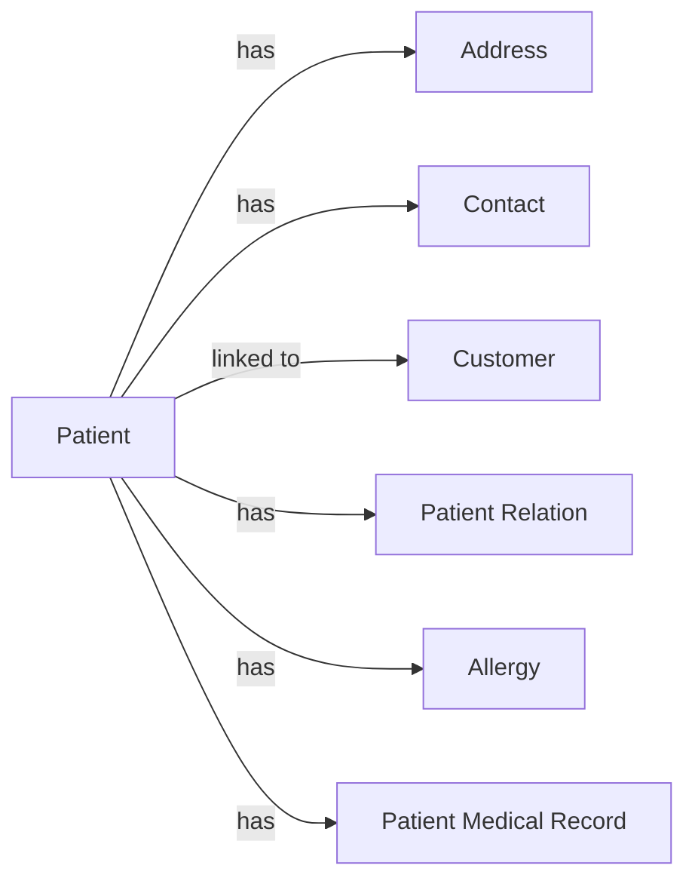

### 2. Appointment & Consultation Module

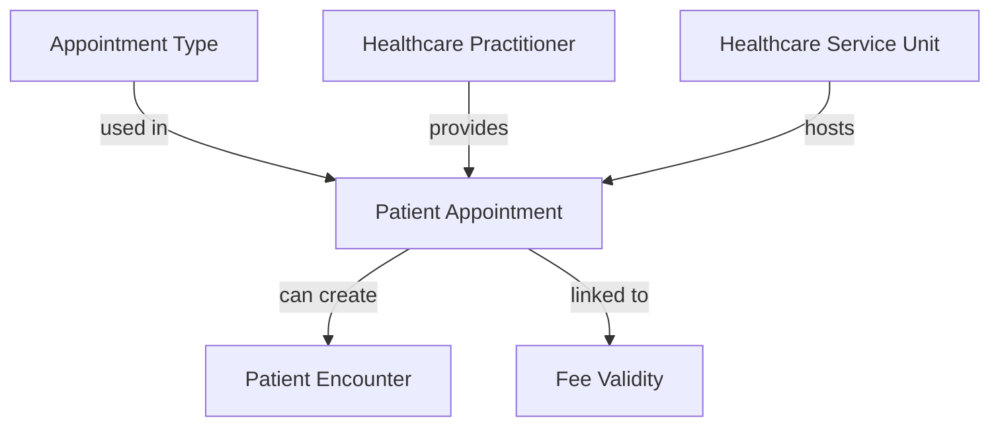

### 3. Clinical Encounter Module

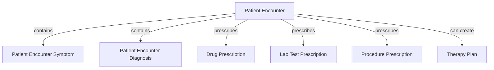

### 4. Laboratory Module

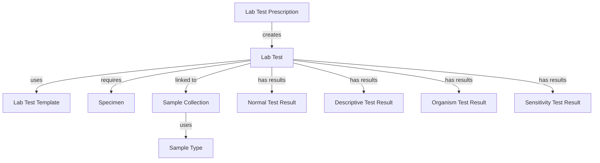

### 5. Clinical Procedures Module

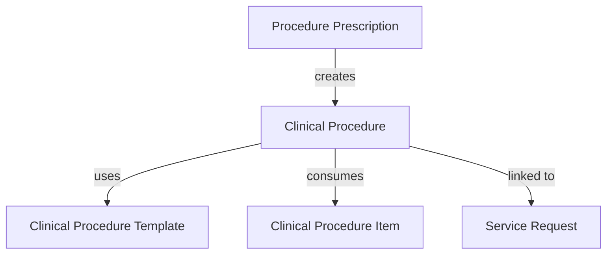

### 6. Therapy & Rehabilitation Module

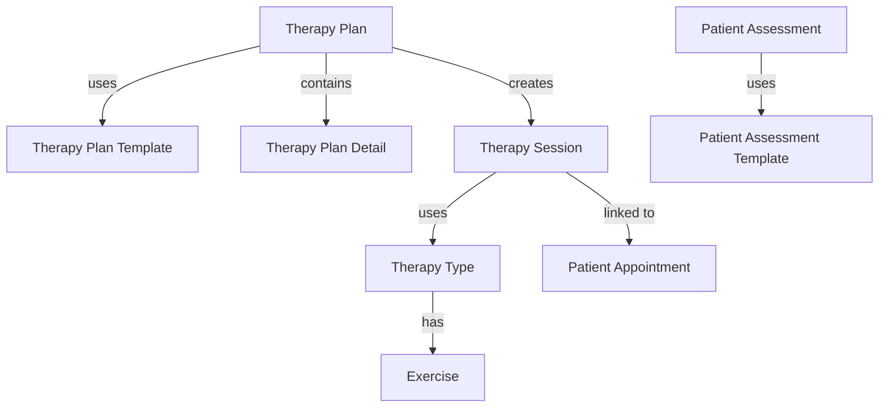

### 7. Inpatient Module

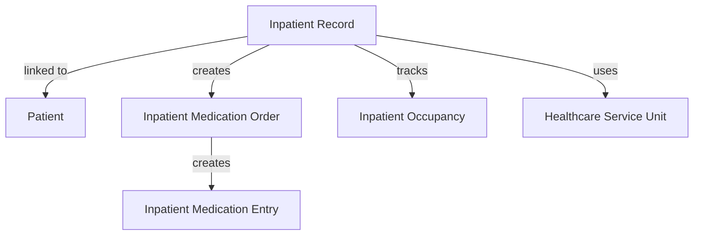

### 8. Medication Management Module

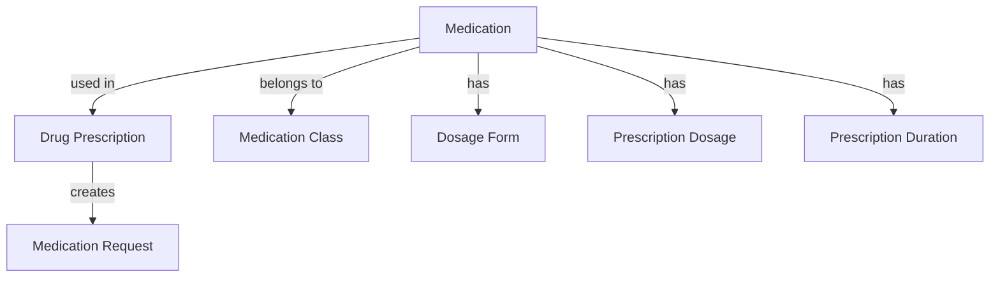

### 9. Service Request & Orders Module

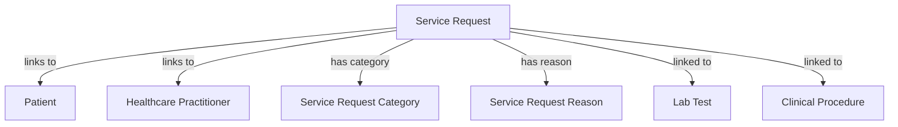

### 10. Templates & Masters Module

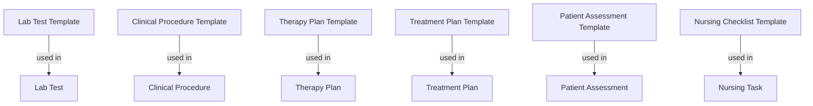

## Key Relationships Summary

### Primary Relationships:
1. **Patient** is the central entity - most documents link to Patient
2. **Patient Appointment** → can create **Patient Encounter**
3. **Patient Encounter** → contains prescriptions (Drug, Lab, Procedure)
4. **Prescriptions** → create actual documents (Lab Test, Clinical Procedure, Medication Request)
5. **Inpatient Record** → manages inpatient-specific documents
6. **Therapy Plan** → creates **Therapy Sessions** linked to Appointments

### Child Table Relationships:
- **Patient Encounter** contains:
  - Drug Prescription (Table)
  - Lab Test Prescription (Table)
  - Procedure Prescription (Table)
  - Patient Encounter Symptom (Table)
  - Patient Encounter Diagnosis (Table)

### Template-Based Documents:
- Lab Test → uses Lab Test Template
- Clinical Procedure → uses Clinical Procedure Template
- Therapy Plan → uses Therapy Plan Template
- Patient Assessment → uses Patient Assessment Template

## Document Status Flow

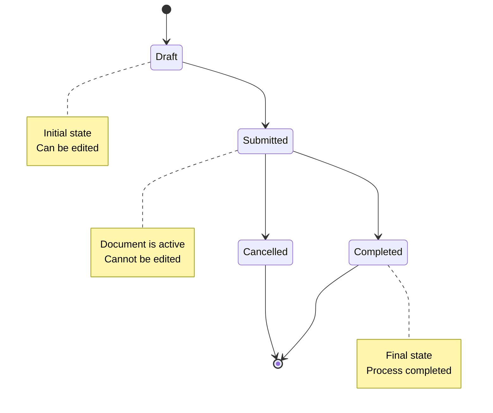

## Notes

- **Patient** is the core entity - all clinical documents reference it
- **Patient Appointment** is the entry point for most clinical workflows
- **Patient Encounter** is where clinical documentation happens
- **Prescriptions** are child tables that create separate documents
- **Templates** define the structure for clinical documents
- **Service Requests** provide a standardized way to request services
- **Inpatient Record** manages all inpatient-related activities

